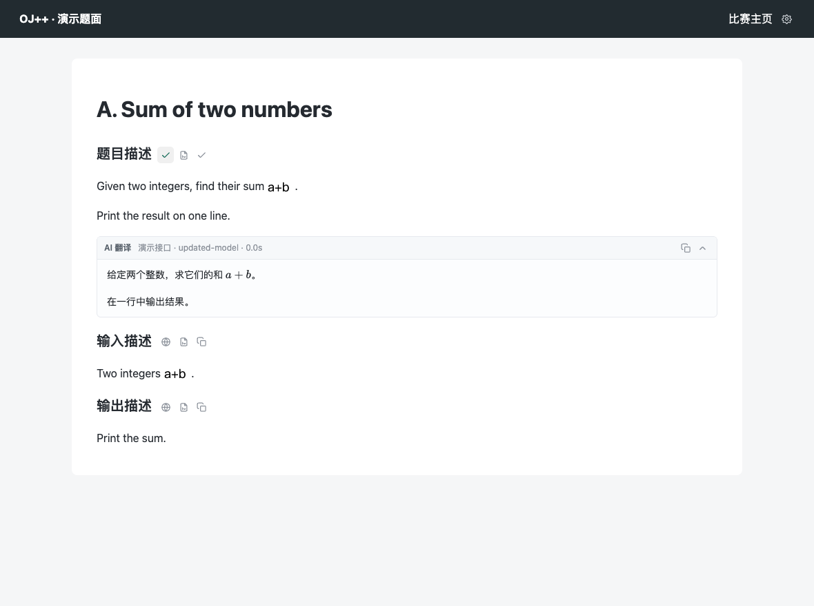
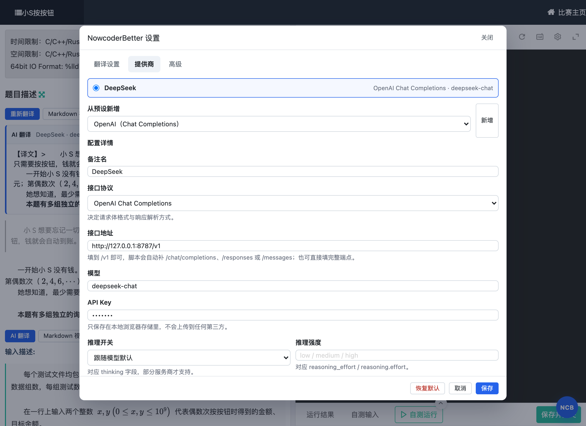

# OJ++

[](https://github.com/hsn8086/OJ-Plus-Plus/releases)
[](LICENSE)
[](dist/oj-plus-plus.user.js)

OJ++（OJ-Plus-Plus）是一个可扩展的在线评测站增强工具。它把 AI 题面翻译、Markdown 查看和复制能力做成通用功能，再通过站点适配器连接具体 OJ，通过运行平台适配器连接 Tampermonkey、Chrome 扩展和浏览器调试环境。

目前内置牛客竞赛、Codeforces、AtCoder、QOJ 和洛谷适配器，提供油猴构建和 Chrome MV3 扩展构建。



## 功能

- **AI 题面翻译**：题目描述、输入/输出描述、题解分别提供翻译按钮，译文显示在原文下方。Codeforces 的博文、评论和私信也有独立翻译按钮。
- **流式显示**：边生成边渲染，首屏更快。可以在设置里关闭；服务商或脚本管理器不支持时自动退回一次性请求。
- **公式保留**：站点适配器先把页面公式还原成 LaTeX，模型翻译后用 KaTeX 渲染。
- **Markdown 查看与复制**：从内容副本生成 Markdown，不替换原页面 DOM，因此页面原有交互可以继续使用。
- **多提供商**：支持 OpenAI Chat Completions、OpenAI Responses、Anthropic Messages，以及自定义地址、请求头和请求体字段。API Key 可以留空，此时不发送认证头，适配本地推理服务。
- **长题面分段**：关闭整段翻译后按标题、段落和行切分内容。
- **代码编辑器**：Codeforces 和 AtCoder 题目页内嵌 CodeMirror 6，支持写码、跑题面样例和自定义测试、一键提交。提交页和自定义测试页的原生 ACE 编辑器也替换为 CodeMirror 6。
- **本地运行（扩展版）**：使用包内 WASM 运行 C11、C++17 和 Python 3.11.3，读取样例和自定义输入，分别显示 stdout/stderr。支持超时、取消、输出上限和编译缓存，不内置 LSP。
- **界面本地化**：设置面板与按钮支持简体中文和英文。目标语言设为中文时，Codeforces、AtCoder 的导航、题面标题、表单等界面文本也会中文化；牛客在目标语言为英文时把界面翻成英文。
- **站点配色**：可选跟随系统、浅色或暗色。五个站点都提供站点暗色适配，脚本界面也随主题切换。
- **按站点开关**：在设置的「站点功能」里分别控制翻译工具栏、自动翻译、界面本地化、站点暗色，以及已支持站点的代码编辑器。保存后即时生效，设置入口始终保留。
- **平台解耦**：通用代码只依赖存储、HTTP 请求和剪贴板接口。油猴平台使用 GM API，浏览器平台使用 `localStorage`、`fetch` 和 Clipboard API。

## 安装

### 油猴版

需要先安装 [Tampermonkey](https://www.tampermonkey.net/) 或 Violentmonkey。

| 版本 | 安装地址 |
| --- | --- |
| 正式版 | [oj-plus-plus.user.js](https://raw.githubusercontent.com/hsn8086/OJ-Plus-Plus/main/dist/oj-plus-plus.user.js) |
| 本地开发版 | 构建后安装 `dist/oj-plus-plus.user.js` |

> 项目原名 NowcoderBetter，2026-10 改名为 OJ++。改名后脚本的 `@namespace` 变了，脚本管理器会把它当成新脚本，配置需要重新填写。

### Chrome 扩展版

```sh
pnpm install
pnpm build:extension
```

打开 `chrome://extensions`，开启开发者模式，选择「加载已解压的扩展」，加载 `dist-extension/`。首次构建会下载并校验固定版本的 WASM 工具链；安装后的运行不需要下载运行时代码。扩展与油猴存储独立，换用扩展时需重新配置提供商，并关闭同站点的油猴脚本以免出现重复界面。

在 OJ 页面编辑提供商后直接点「测试连接」即可；新域名未授权时会打开授权页，授权后测试自动继续。也可以在工具栏 OJ++ 图标的选项页为服务域名预授权。扩展包、使用范围和测试命令见 [扩展版说明](docs/extension.md)。

## 第一次使用

1. 打开受支持的题目页，点击页面上的齿轮。
2. 在「提供商」页选择预设，填写 API Key 和模型。
3. 点击「测试连接」，确认接口返回成功后保存。
4. 点击题目标题旁边的翻译图标。



默认模型是 `gpt-6-luna`。`temperature`、`top_p`、`max_tokens` 等参数统一写在「额外请求体字段」中，不再单独显示表单字段。

### AtCoder

题面按当前显示的日文或英文版本收集，题目、约束、输入、输出和样例说明可分别翻译，比赛介绍、题解详情页与公告文章也提供工具栏。自动翻译可在设置中按站点开启。

油猴版测试使用当前比赛的官方自定义测试接口，需先登录；扩展版可在「站点运行 / 本地 WASM」之间选择。本地运行按顺序执行，程序用时以浏览器实测为准。stderr 单独显示，不参与答案比较；有诊断输出时保留展开状态。启用 OJ++ 编辑器后，隐藏重复的原生提交控件，保留 Cloudflare 验证组件。提交仍使用原生表单字段，出现人机验证时需先完成验证。

### QOJ 与洛谷

QOJ 的 HTML 题面可翻译、查看 Markdown 和复制；PDF 题面会先提取文本，保留原 PDF 供对照。PDF 提取不包含 OCR，扫描件以及用图形绘制的数学符号无法可靠还原，公式请对照原件。PDF.js 随 userscript 打包，不额外加载 CDN 代码。

洛谷按背景、描述、输入、输出和提示收集内容，样例保留原样。优先读取页面数据中的原始 Markdown，避免从渲染后的公式反推 LaTeX；切换题目会清理上一题的译文。扩展版为 QOJ、洛谷提供本地运行编辑器，正式提交仍使用原生入口。QOJ 的 PDF 题目可手动添加自定义测试，暂不从 PDF 文本自动识别样例。

关闭「站点界面本地化」会恢复原文；关闭「站点暗色适配」只恢复该站点的配色，OJ++ 设置面板仍按全局主题显示。关闭翻译工具栏也会停用该站点的自动翻译。

### 协议选择

| 协议 | 路径 | 请求字段 | 认证头 |
| --- | --- | --- | --- |
| OpenAI Chat Completions | `/chat/completions` | `messages` | `Authorization: Bearer` |
| OpenAI Responses | `/responses` | `input` | `Authorization: Bearer` |
| Anthropic Messages | `/messages` | `system` + `messages` | `x-api-key` |

接口地址填写到 `/v1` 即可，脚本会按协议补全路径；也可以直接填写完整端点。

### 流式显示

开启后请求会带上 `stream: true`，脚本按 SSE 解析增量并逐帧渲染。三处细节值得说明：

- 油猴的流式路径使用 `GM_xmlhttpRequest` 的 `responseType: 'stream'` + `partialSize`。Tampermonkey 会在 `onreadystatechange` 阶段向用户脚本暴露 `ReadableStream`；分片要从 `res.response.getReader()` 读取。`onprogress` 只带进度字段，等 `onload` 才开始读流已经太晚。正常情况下 `onloadend` 关闭流；部分版本只派发 `onload` 时，脚本会等待已排队分片后兜底收尾。
- 不支持 `responseType: 'stream'` 的脚本管理器不会提供可读流，此时自动改走一次性请求（回退请求会去掉 `stream` 参数，否则服务端仍返回 SSE 而无法按 JSON 解析）。
- 已经开始输出后再中断不会重试，避免面板内容回退重来。
- 正文随时可能停在半个公式、半个代码块或半个粗体上。渲染前会做两件事：
  - 结构标记（粗体、斜体、删除线、链接）由 [remend](https://www.npmjs.com/package/remend) 补全。补全不改变可见文字，所以 `**注意` 能立刻以粗体显示，收尾符到达时也不会重画。
  - 公式不能补全。把 `$a+` 补成 `$a+$` 会先把半截公式渲染出来，真内容到达时又得重画。所以未闭合的公式会被隐去，等闭合后再显示。
- 如果流已经开始输出后又中断，不会重新开始，避免用户看到内容回退。

## 代码结构

```text
src/
  app.ts                 通用应用组合根
  brand.ts               产品名和仓库地址
  core/
    ai.ts               重试、错误处理、AI 请求
    config.ts           配置结构、预设与迁移
    providers.ts        三种协议的请求构造与响应解析
    prompt.ts           翻译提示词与分段
    sse.ts              SSE 增量解析
    settings-store.ts   平台无关的配置读写
    translate.ts        分段翻译编排
    types.ts            通用配置和协议接口
  i18n/
    zh.ts               中文文案，同时是键的定义来源
    en.ts               英文文案
    index.ts            取词、占位符替换、语言解析
  sites/
    types.ts            OJ 站点适配器接口
    index.ts            站点注册和 URL 分派
    nowcoder.ts         牛客选择器、公式和动态 DOM 适配
    codeforces.ts       Codeforces 选择器、老题与新题两套公式还原
    atcoder.ts          AtCoder 双语题面、题解和公式还原
    atcoder-editor.ts   AtCoder 语言列表、官方测试、提交与 ACE 同步
    atcoder-i18n.ts     AtCoder 界面词典
    atcoder-styles.ts   AtCoder 暗色样式
  platforms/
    types.ts            存储、HTTP、剪贴板接口
    userscript.ts       Tampermonkey / Violentmonkey 实现
    browser.ts          普通浏览器调试实现
    extension.ts        MV3 存储、HTTP/流式与本地运行桥
  extension/            后台、Offscreen 宿主、WASI Worker、权限页与页面桥
  execution/            本地运行请求、语言与校验
  ui/
    section.ts          区域工具栏和翻译流程
    result-panel.ts     通用译文面板
    settings-panel.ts   通用设置面板
    markdown.ts         HTML 副本到 Markdown、KaTeX 渲染、流式稳定化
    buttons.ts          图标按钮和复制反馈
    theme.ts            主题解析与应用
    styles.ts           通用样式（含暗色）
  entries/
    userscript.ts       油猴入口
    browser.ts          浏览器调试入口
```

### 添加一个 OJ

实现 `SiteAdapter`：

- `collectSections` 返回题目描述、输入、输出或题解区域。
- `prepareContent` 在内容副本上处理公式、代码和站点特殊节点。
- `mountSettingsButton` 决定设置入口放到站点哪里。
- `observe` 监听站点的异步渲染，并在页面变化时调用回调。

然后把适配器加入 `src/sites/index.ts`。通用翻译、Markdown 和设置代码不需要修改。

### 添加界面文案

界面文字都走 `src/i18n`：

1. 在 `zh.ts` 加键，中文即默认文案。
2. 在 `en.ts` 补对应英文。两份文件的键集合必须一致，`test/i18n.test.ts` 会检查，也会检查占位符是否两边都在。
3. 代码里用 `t('key', { name: 'x' })` 取值，占位符写成 `{name}`。

未支持的语言会回退英文，而不是回退中文，避免出现半截中文。

### 给站点加暗色主题

在适配器里提供 `darkStyles`，选择器挂在 `html[data-ojpp-theme="dark"]` 下：

```ts
export const site: SiteAdapter = {
  darkStyles: `
    html[data-ojpp-theme="dark"] .my-statement { color: #cdd9e5; }
  `,
};
```

只覆盖阅读相关的部分（正文、链接、代码块、表格），不要去改导航栏和按钮，否则容易把站点自己的配色改坏。站点自身有暗色模式时不必提供。

### 添加一个运行平台

实现 `Platform`：

```ts
interface Platform {
  readonly id: string;
  readonly storage: Storage;
  readonly request: HttpTransport;
  readonly stream?: HttpStreamTransport;
  readonly writeClipboard: (text: string) => Promise<void>;
}
```

`stream` 是可选的，不实现就退化为一次性请求。它的回调收到的是**累计**原始响应文本。浏览器平台把 `ReadableStream` 的增量片段拼成累计文本；油猴平台从 Tampermonkey 的 `res.response` 读取同一个 `ReadableStream` 后再累积，核心层不需要知道具体脚本管理器。

Chrome 扩展可以把 `storage` 映射到 `chrome.storage.local`，把 `request` 放到扩展后台或 service worker，再使用一个新的入口调用 `startApp`。页面功能不需要知道请求来自 GM API 还是扩展消息通道。

## 开发与验证

```bash
pnpm install
pnpm check          # 类型检查、单元测试、构建油猴脚本
pnpm test:browser   # 牛客与 Codeforces 离线浏览器回归
pnpm test:atcoder   # AtCoder 双语题面、公式、翻译与语言切换回归
pnpm test:sites     # QOJ HTML/PDF、洛谷原始 Markdown、各站点开关回归
pnpm build:extension # 构建 MV3 扩展及包内运行时
pnpm test:extension  # 实际加载扩展，验证 C/C++/Python、流式请求、取消与限额
pnpm pack:extension  # 用 7z 打包为可分发的 ZIP
pnpm screenshots     # 生成 README 截图
```

浏览器回归会使用本地 fixture，不启动 mock AI 服务，也不依赖真实 OJ 页面。它覆盖：

- 油猴构建的回归会模拟 Tampermonkey 在 `onreadystatechange` 中提供 `ReadableStream`，页面 `fetch` 被故意禁用，验证流分片仍能逐步进入译文面板。
- 牛客站点公式还原、Markdown、复制、动态插入和结果渲染。
- Codeforces 两种公式形态：老题的服务端 `.tex-span` HTML 按结构还原成 LaTeX，新题的 MathJax 源码直接取用，且渲染副本不重复。
- 工具栏靠右对齐：断言它与标题同一行且贴住容器右侧，而不是只看 CSS 类名。
- 暗色主题与界面语言：主题属性落到 `<html>`，题面文字确实变浅，英文界面下按钮文案为英文。
- 流式请求：请求体带 `stream`，中途就能看到部分译文，完成后流式状态清除。
- 设置面板输入焦点、文本拖拽、保存后即时切换配置、取消请求和重复翻译。
- 另一套 DOM 与浏览器平台，验证通用应用不依赖牛客选择器。

本机没有 Playwright 管理的浏览器时，可以指定已有 Chromium：

```bash
OJPP_CHROME=/path/to/Google\ Chrome\ for\ Testing pnpm test:browser
```

## 请求与数据

油猴构建只通过 `GM_xmlhttpRequest` 发 AI 请求，API Key 通过 `GM_setValue` 保存在脚本管理器存储中。普通浏览器入口只用于本地调试，使用 `fetch`，仍然受 CORS 限制；它不会作为油猴脚本的隐藏回退路径。

请求地址是用户在设置面板中填写的地址，项目没有中转服务。配置预览会隐藏 API Key；翻译内容会发送给选定的 AI 提供商。

## 故障排查

**测试连接提示 `Failed to fetch`。** 检查安装的是 `oj-plus-plus.user.js`，而不是把构建产物直接作为普通网页脚本加载。油猴构建需要 `GM_xmlhttpRequest` 权限；直接浏览器调试入口使用 `fetch`，服务端必须允许 CORS。

**返回 401 或 403。** 检查 API Key、模型名和接口协议是否匹配。可以先用「测试连接」查看服务商返回的错误。

**用本地推理服务，没有 Key。** 把 API Key 留空即可，脚本不会发送认证头。如果服务要求任意非空 Key，在「额外请求头」里手动写 `Authorization: Bearer dummy`。

**译文一直不出来，进度条在转。** 如果服务商不支持流式，脚本会在首帧之后自动改走一次性请求；若一直没结果，关掉「流式显示」再试，或点翻译按钮中止后查看错误提示。

**公式显示为源码。** 确认 KaTeX CSS 可以从 jsDelivr 加载。公式的 Markdown 仍会保留 LaTeX，复制结果不受影响。

**从 NowcoderBetter 升级后配置没了。** 脚本管理器的 GM 存储按脚本 uuid 隔离，uuid 由 `@namespace` + `@name` 决定。改名后 uuid 变了，旧配置读不到，需要重新填一次 API Key 和模型。

## 反馈

请在 [GitHub Issues](https://github.com/hsn8086/OJ-Plus-Plus/issues) 提交问题。报错时附上协议、状态码和脱敏后的响应信息，不要提交 API Key。

## 许可

[GPL-3.0](LICENSE)。公式处理思路参考了 [OJBetter](https://github.com/beijixiaohu/OJBetter)。PDF 文本提取使用 [PDF.js](https://github.com/mozilla/pdf.js)，许可证为 [Apache-2.0](docs/licenses/pdfjs.txt)。
