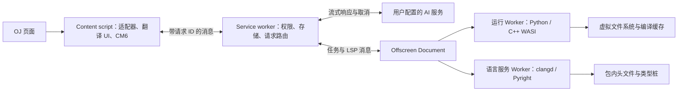

# CRX、WASM 本地测试与 LSP 调研

核验日期：2026-10-10。以下保留当时的调研与独立实验记录。后续已决定不内置 LSP，并实现了 MV3 扩展及 C/C++/Python 本地运行，当前用法见 [扩展版说明](../extension.md)。本文件中的 clangd/Pyright 方案不属于当前发行构建。

## 已验证的能力

在临时 Chrome 扩展中，用 Offscreen Document 创建 Dedicated Worker，实际执行了以下流程。扩展和浏览器 profile 均为临时目录，实验结束后删除。

| 项目 | 实测结果 | 尚未覆盖 |
| --- | --- | --- |
| MV3 扩展内 WASM | WASM `add(20, 22)` 返回 `42` | 正式 UI、分发与更新 |
| 多线程所需环境 | Offscreen 文档和 Worker 均 `crossOriginIsolated=true`；可创建共享 WASM Memory | 各浏览器及不同 Chrome 版本 |
| 终止失控计算 | 独立 Worker 的死循环可终止，本次定时器约 63 ms 后返回 | 编译器及用户程序的完整资源计量 |
| Python 本地运行 | Pyodide 314.0.7 读取 stdin `20 22`，stdout 为 `42`，stderr 为 `debug-stderr` | 多样例隔离、超时恢复、包兼容性 |
| C++ WASM LSP | clangd 18.1.2 初始化成功，对自定义函数 `square` 返回语义补全 | STL、`bits/stdc++.h`、PBDS、持续诊断、大文件、多标签页 |
| 网页内扩展 iframe | 普通顶层页及内嵌扩展 iframe 的 `crossOriginIsolated` 均为 false | 不作为多线程引擎的首选宿主 |

最后一项中，当前 Chrome 仍向扩展 iframe 暴露了 `SharedArrayBuffer` 构造器。不能仅凭构造器存在就认定上下文已隔离；本方案选择已实测隔离成立的 Offscreen 宿主。

完整结果见 [实验输出](crx-wasm-probe.json)。Chrome 版本为 `151.0.7922.34`。包内本地资源加载的单次测量中，Pyodide 加载约 1.10 秒，clangd 加载及一次补全约 0.40 秒；这些数字不代表首次下载、商店安装、低配设备或大型工程性能，也未测内存峰值。

C++ **编译并执行测试点**尚未实测。clangd 能做语义分析，不是运行用户程序的编译器/链接器。

## 扩展结构

现有 `startApp(platform, site)` 可以保留，五个站点的选择器、翻译 UI、CM6 和站点开关可以复用。增加单独的 MV3 构建入口，不直接把 `.user.js` 塞进扩展；油猴的 GM API、SystemJS 包装及页面世界访问方式不适合作为扩展入口。



建议新增的边界：

- `src/platforms/extension.ts`：实现现有 `Platform` 的存储、HTTP、流式响应和剪贴板契约。
- `src/extension/background.ts`：管理域名权限、取消请求、连接断开、Offscreen 生命周期和标签页路由。
- `src/extension/offscreen.*`：按需创建运行器与 LSP Worker；空闲时释放。一个扩展通常只有一个 Offscreen Document，内部可以管理多个 Worker。
- `src/execution/`：统一官方自定义测试与本地 WASM 后端；本站提交仍由 `SiteAdapter` 处理。
- `src/editor/lsp-transport.ts`：把 WebSocket 与 Worker 消息传输从 LSP 客户端中分离。
- 独立构建目录 `dist-extension/`：多文件 JS、WASM、字体、头文件和类型桩。不会覆盖 `dist/oj-plus-plus.user.js`。

先用独立 Vite 配置构建 MV3 即可；需要多浏览器构建、自动重载和打 ZIP 时可用 WXT。LeetSense 使用 WXT，但 OJ++ 无需为此重写 UI。

### 当前代码需要调整的地方

| 现有位置 | 改动 |
| --- | --- |
| [`Platform`](../../src/platforms/types.ts) | 跨域 AI 请求转发到扩展后台；SSE 通过 Port 转发，保留累计文本及 AbortSignal 语义 |
| [`browser.ts`](../../src/platforms/browser.ts) | 目前是普通网页 `fetch`/localStorage 实现，不能直接充当扩展后台适配器 |
| [`app.ts`](../../src/app.ts) | 样式注入需要考虑站点 CSP；必要时使用扩展 `insertCSS`/`removeCSS`；卸载时清理会话 |
| 各站点 `syncBack` | 依赖 `unsafeWindow` 的 ACE 同步改成窄接口 MAIN-world 桥；不能开放任意字符串执行或任意 URL 代理 |
| [`editor-panel.ts`](../../src/ui/editor-panel.ts) | 增加本地/站点运行后端选择；保留统一测试列表、stdout/stderr、取消和自定义样例 |
| [`lsp.ts`](../../src/editor/lsp.ts) | 目前补全请求发生在 `syncDoc` 之前，会读到旧文档；需先同步版本，再请求补全。还需 didClose、诊断、悬浮提示与资源清理 |
| [`cm.ts`](../../src/editor/cm.ts) | 按文档生命周期连接 LSP；不能只在点补全时同步。每题、每标签页使用独立 URI |

当前 `SiteEditorSupport.runCustomTest` 使用 CF/AtCoder 的语言编号。本地运行器需要语言族、标准和运行时版本的独立描述，不能把某站点的 languageId 直接当作本地编译器参数。

## Chrome 的几个硬约束

### WASM 与跨源隔离

已验证的 manifest 配置：

```json
{
  "manifest_version": 3,
  "permissions": ["storage", "offscreen"],
  "background": { "service_worker": "background.js", "type": "module" },
  "cross_origin_opener_policy": { "value": "same-origin" },
  "cross_origin_embedder_policy": { "value": "require-corp" },
  "content_security_policy": {
    "extension_pages": "script-src 'self' 'wasm-unsafe-eval'; object-src 'self'"
  }
}
```

默认扩展 CSP 不启用 WASM；`wasm-unsafe-eval` 允许 WASM 编译，但不等于允许 JS `eval`。引擎加载器、Worker 和 WASM 都应使用包内 URL。

Offscreen 通过 `reasons: ['WORKERS']` 创建。它可用普通 Web API，但扩展 API 主要限于 `runtime`，所以权限管理、扩展存储和标签页信息由 service worker 负责。

Service worker 可能在空闲 30 秒后停止，也有请求生命周期限制；只打开一个 Port 不会永久保活。编译器和 LSP 不应依赖 service worker 全局变量常驻。AI 流式请求也要处理后台停止及重连，不能仅靠“已经连了 Port”保证完整性。

### 包体与下载

Chrome Web Store 的远程托管代码规则包含 **JS 和 WASM**。商店版需要把 clangd、Python/C++ 运行时、Worker 加载器等代码打进扩展。可以按需加载**包内**资源，但不能默认从 CDN 下载新 WASM 来执行。

本次核验的 `clangd.wasm` 是 90,164,050 字节（约 86 MiB），不含其他资产。Pyodide 314.0.7 的 npm 包解压约 13.9 MB。C++ 编译器、链接器和 sysroot 会继续增加体积，需单独测量。大型运行时和编译缓存不放进 `chrome.storage.sync`；设置用扩展存储，缓存用扩展来源的 IndexedDB 并设置回收策略。

内容脚本的固定站点权限可以从现有 `siteMatches` 生成。AI 服务域名建议通过 `optional_host_permissions` 按用户配置申请，避免初装就要求所有网站访问权限。

### 安装与分发

开发阶段输出目录，使用 `chrome://extensions` 的“加载已解压的扩展”。正式商店上传 ZIP，由商店签名、更新。CRX 是签名分发格式，不是把 ZIP 改后缀。

Windows/macOS 上不能把任意自签 CRX 当成面向普通用户的通用安装方案；公开发行优先 Chrome Web Store，企业策略另论。Linux 支持额外的自托管/本地 CRX 安装方式。若自行签名，私钥需单独保存且不可入库；扩展 ID 和更新链依赖稳定的签名身份。

## 本地跑测试点

### Python：可以先落地

本次在 MV3 的严格 CSP 下实测 Pyodide 成功，不需要 JS `unsafe-eval`。`setStdin`、`setStdout`、`setStderr` 能直接接现有测试行。

每次测试使用独立文件系统/执行状态，避免上一条测试的模块、全局变量和文件残留。编译及执行放 Worker，主线程用 watchdog 终止超时 Worker；有共享内存时可以再加 Pyodide 中断缓冲区。

Pyodide 是 CPython WASM，不是牛客/CF 的 PyPy。第三方包也不能假定全部可用。Pyodide 自带 JS 桥接，正式运行器还需要核验网络与宿主能力的隔离；AI 凭据不应交给执行用户代码的 Worker。

### C++：路线明确，需单独验证工具链

优先评估 [Runno 的 `clangpp` 与 headless API](https://github.com/taybenlor/runno/tree/main/packages/runtime)，或自己打包 Clang/LLD + WASI sysroot。流程是：C++ 源码 → 浏览器内编译/链接 → WASM → WASI 运行器提供 stdin、stdout、stderr 和虚拟文件系统。

要核对候选工具链的所有资源 URL，替换远端 WASM/Worker 加载路径，并验证 CSP、sysroot 和版本。`binji/wasm-clang` 是早期 alpha 示例；`tbfleming/cib` 的 README 明确列出 stdin/cin 等缺失，不能直接当作生产运行器。

竞赛代码的验收集至少包括 `bits/stdc++.h`、STL、`__int128`、PBDS、异常、递归、浮点格式和大输入。WASI/Clang 与 OJ 的 Linux/GCC、libstdc++ 不完全一致；通过本地样例不能保证正式评测通过。

### 执行契约

- 每份源码编译一次，多条样例复用编译产物；缓存键包含源码、编译器版本、flags 和 sysroot 版本。
- 每条测试重新实例化运行环境；自定义样例仍在题面样例之前。
- 本地后端先限制为单任务执行，测量内存后再考虑并发；不要照搬 CF 的并发 3。
- stdout/stderr 独立采集并限制大小；支持取消、超时、异常和编译失败。
- 测试数据使用已经公开的样例及用户输入。扩展拿不到 OJ 隐藏测试数据。
- 浏览器 wall time、WASM 线性内存与 OJ 的 CPU 时间/RSS 不是同一指标；无法准确获取的统计要标为未知，不能伪造为 0。

## 本地 LSP

C++ 可使用 clangd WASM。运行时之外，还需匹配版本的 builtin headers、标准库头文件、编译参数和虚拟目录。此次补全验证使用无标准库依赖的自定义函数，STL 与竞赛扩展头文件需要下一轮验收。该构建的 stdio 桥接需要 `Content-Length` 分帧，并在头部、空行与消息体之间保留读取边界；直接把一整串字节送入 stdin 会导致握手停滞。

Python 建议评估 `browser-basedpyright`。它主要是 JavaScript Worker，不必为了“统一 WASM”把 Python 的静态分析器也放进 CPython。Python 执行与 Python LSP 是两个服务。

CM6 接入应补齐：

1. initialize/initialized、didOpen、先于请求发送的 didChange、didClose。
2. completion 的 textEdit/range 与文档版本；迟到响应不能覆盖新文档。
3. publishDiagnostics、hover、signatureHelp、取消与重启。
4. 多题唯一 URI；共享语言进程，按文档注册，避免一标签页一份 90 MB clangd。
5. 空闲回收、引擎崩溃后的重建，以及编译器/LSP 的独立队列。

现有 WebSocket LSP 保留为备用传输，对大型项目或暂不支持的语言仍有价值。

## 建议实施顺序

1. **MV3 基础扩展**：复用五站适配、设置、AI 翻译和 CM6，完成存储/请求/流式/页面桥与独立打包。先验收与油猴行为一致。
2. **Python 本地测试**：将已验证的 Pyodide 流程接入测试列表，完成清理、超时、取消及输出限额。
3. **本地 LSP**：接 clangd 与浏览器版 Pyright；先补全、诊断、悬浮提示，验证 STL 和文档版本。
4. **C++ 本地测试**：对 Runno/Clang-WASI 做独立工具链验收，再接统一后端。测量包体与内存后决定是否拆分精简版和完整工具链版。

现阶段无需把 WASM 大运行时塞进油猴产物，也不需要替换 CM6。CRX 可以多文件分发，更适合工具链和 Worker 资源。

## 复现实验

基础隔离与 WASM 验证：

```sh
node tools/probe-extension-wasm.mjs /tmp/ojpp-wasm-result.json
```

另外指定本地资产目录，可以重跑此次语言引擎验证：

```sh
OJPP_PYODIDE_DIR=/path/to/pyodide/package \
OJPP_CLANGD_DIR=/path/to/clangd \
node tools/probe-extension-wasm.mjs /tmp/ojpp-wasm-result.json
```

Pyodide 目录来自 npm 的 `pyodide@314.0.7`，需包含 `pyodide.js`、`pyodide.asm.mjs`、`pyodide.asm.wasm`、`python_stdlib.zip` 和 lock 文件。clangd 目录需包含 `clangd.js`、`clangd.wasm`、`clangd.worker.mjs`。

此次 clangd 资产来自 LeetSense 提交 `61fff6998aaaabdd63d55244b74272479c691f48` 的 `public/clangd/`，其 NOTICE 追溯到 TypeFox 的 LLVM 18.1.2 构建。实验脚本与结果入库，第三方二进制只下载到临时目录，没有加入 OJ++ 依赖或发行包。

- `clangd.wasm` SHA-256：`6ab3801712c12703855afec9a71e24f93a2011c607ae0758d901650cde8989d6`
- `pyodide-314.0.7.tgz` SHA-256：`66b7949e5a0cba2250b586d7e368bf12fb482800748d182c4618254b685ffaa0`

## 核对来源

- Chrome：[扩展 CSP 与 WASM](https://developer.chrome.com/docs/extensions/reference/manifest/content-security-policy)、[Offscreen](https://developer.chrome.com/docs/extensions/reference/api/offscreen)、[COEP](https://developer.chrome.com/docs/extensions/reference/manifest/cross-origin-embedder-policy)、[COOP](https://developer.chrome.com/docs/extensions/reference/manifest/cross-origin-opener-policy)。
- Chrome：[service worker 生命周期](https://developer.chrome.com/docs/extensions/develop/concepts/service-workers/lifecycle)、[远程托管代码规则](https://developer.chrome.com/docs/extensions/develop/migrate/remote-hosted-code)、[安装与分发限制](https://developer.chrome.com/docs/extensions/how-to/distribute/install-extensions)。
- Pyodide：[Web Worker](https://pyodide.org/en/stable/usage/webworker.html)、[stdin/stdout/stderr](https://pyodide.org/en/stable/usage/streams.html)。
- [clangd-in-browser](https://github.com/guyutongxue/clangd-in-browser)：多线程与隔离要求；嵌入网页也需考虑宿主隔离。
- [LeetSense 固定版本](https://github.com/C-W-D-Harshit/leetsense/tree/61fff6998aaaabdd63d55244b74272479c691f48)：已阅读 manifest、Offscreen 引擎、clangd Worker 与 LSP 分帧实现。它的 README 当时仍标注商店审核待完成，不能当作已获商店批准的证据。
- [Runno](https://github.com/taybenlor/runno)、[wasm-clang](https://github.com/binji/wasm-clang)、[cib](https://github.com/tbfleming/cib)：C++ 本地编译/运行路线及现有限制。
